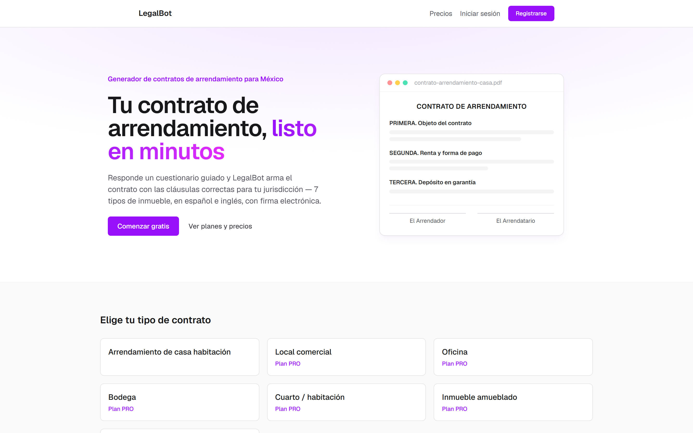

  
  

## Herramientas

  
  
  
  
  
  
  
  
  
  
  
  

## Lo que estoy construyendo

**LegalBot** arma contratos de arrendamiento para México: respondes un cuestionario guiado y te entrega el contrato con las cláusulas correctas para tu estado, en PDF o Word, listo para firmarse electrónicamente.

- **7 tipos de contrato** con reglas por estado (CDMX, Edomex, Jalisco y Nuevo León), incluido el tope legal de aumento de renta en CDMX
- **Pagos reales con Stripe:** suscripciones, portal de facturación y webhooks que activan el plan
- **Firma electrónica** con seguimiento por webhook y **asistente con IA** (Claude) para dudas sobre cada contrato
- Exportación a **PDF y Word**, contratos **bilingües** y anexos automáticos
- Login con correo o Google, recuperación de contraseña y plan Empresa multiusuario con marca propia

`Next.js 16` `React 19` `TypeScript` `PostgreSQL` `Prisma` `Stripe` `Vitest`

**Roadmap**
- [x] Cuestionario guiado y generación de contratos por estado
- [x] Pagos con Stripe y planes FREE / PRO / EMPRESA
- [x] Firma electrónica y asistente con IA
- [x] Recuperación de contraseña por correo
- [ ] Lanzamiento en producción
- [ ] Más estados de la República

> El código es privado; con gusto hago una demo en vivo.

## Otros proyectos

| Proyecto | Qué hace | Stack |
| --- | --- | --- |
| [**mva-hackathon-2026-track1**](https://github.com/JGOM04/mva-hackathon-2026-track1) | MVA Hackathon 2026: pipeline que prioriza variantes genéticas candidatas a partir del fenotipo del paciente, con visualizaciones de resultados | Python · NumPy · matplotlib |
| [**conversor-unidades**](https://github.com/JGOM04/conversor-unidades) | Conversor de unidades hecho a partir de requerimientos y casos de prueba documentados, con suite automatizada | Python · pytest |
