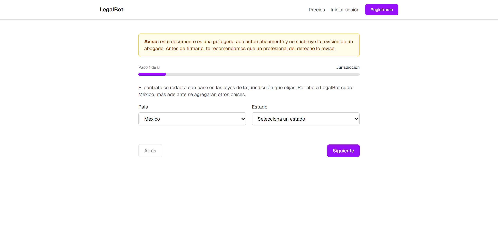

<h1 align="center">Hola, soy Joshua 👋</h1>

  <b>Estudiante de Ingeniería de Software · México</b> 
  Construyo productos web de punta a punta con TypeScript y Next.js, y me interesan el testing y el análisis de datos con Python.

---

### 🚀 Proyecto destacado: LegalBot

**Generador de contratos de arrendamiento para México.** El usuario responde un cuestionario guiado y LegalBot arma el contrato con las cláusulas correctas para su estado, listo para descargar en PDF o Word y firmar electrónicamente.

  
  

- **7 tipos de contrato** con reglas por jurisdicción (CDMX, Edomex, Jalisco y Nuevo León), incluido el tope legal de aumento de renta en CDMX.
- **Pagos reales con Stripe:** suscripciones, portal de facturación y webhooks que activan el plan.
- **Firma electrónica** integrada vía webhook y **asistente con IA** (Claude) para resolver dudas sobre cada contrato.
- **Exportación a PDF y Word**, contratos bilingües (español/inglés) y anexos automáticos.
- **Cuentas** con correo/contraseña, login con Google y recuperación de contraseña; plan Empresa multiusuario con marca propia.
- Tests con **Vitest**.

`Next.js 16` `React 19` `TypeScript` `Tailwind CSS` `PostgreSQL` `Prisma` `Stripe` `Vitest`

> El código es privado; con gusto hago una demo en vivo.

---

### 🧪 Otros proyectos

| Proyecto | Descripción | Stack |
| --- | --- | --- |
| [**mva-hackathon-2026-track1**](https://github.com/JGOM04/mva-hackathon-2026-track1) | MVA Hackathon 2026: pipeline que prioriza variantes genéticas candidatas a partir del fenotipo del paciente, con visualizaciones de resultados. | Python · NumPy · matplotlib |
| [**conversor-unidades**](https://github.com/JGOM04/conversor-unidades) | Conversor de unidades desarrollado a partir de requerimientos y casos de prueba documentados, con suite de pruebas automatizadas. | Python · pytest |

---

### 🛠️ Tecnologías

  
  
  
  
  
  
  
  
  
  
  
  

---

### 🎯 Ahora mismo

- Llevando **LegalBot** a producción.
- Profundizando en **pruebas de software**: caja blanca, niveles de prueba y manejo de excepciones.
